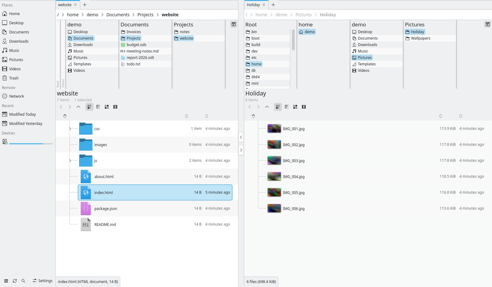
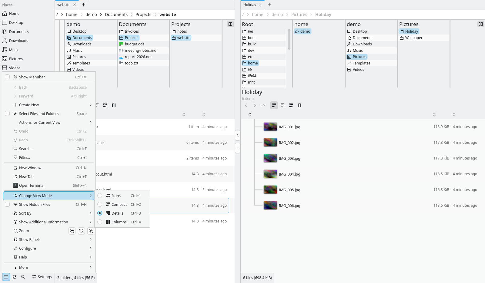
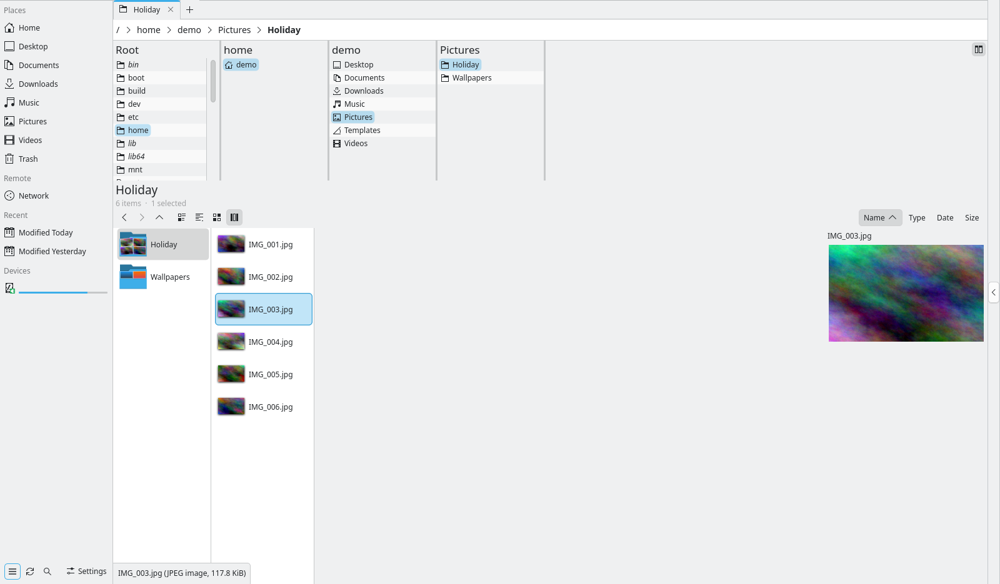

# dolphinCommander

dolphinCommander is a fork of [Dolphin](https://apps.kde.org/dolphin/), KDE's file manager, that works more like [OneCommander](https://onecommander.com/): two panes side by side, each with its own tabs, a path bar and Miller columns, and one row of buttons below the places instead of menus and a toolbar.

It is an independent project and is not affiliated with or endorsed by KDE.

> **Status:** experimental and used by its author. It builds and runs, but it has not been tested widely and the unit tests have not been updated for the new window layout.

## Screenshots


*Two sides, each with its own tabs, path bar and Miller columns. The places and the button row are on the left.*


*Everything that was in Dolphin's menus and toolbar is in the menu button below the places.*


*The right side hidden with the arrows on the divider, and a folder of pictures in the Icons view.*


*The Columns view, with a preview of the selected file on the right.*

## What is different from Dolphin

- **Two panes, always.** The window is split into a left and a right side. Each side has its own tab bar and its own tabs, with a new-tab button that is always visible.
- **Hide either side.** Two arrows in the middle of the divider hide the left or the right side. The divider then stays at the window edge and the same arrows bring the side back. Dragging the divider to an edge does the same.
- **Copy and move between sides.** `F5` copies and `F6` moves the selection to the folder shown in the other side. `Ctrl+F3` moves the keyboard focus to the other side. "Open in Other Pane" is in the context menu.
- **Double-click to go up.** Double-clicking empty space in a folder goes up one folder. You can change that in Settings under View, General.
- **Path bar above each side.** Every side has a large breadcrumb path bar that always shows the full path.
- **Miller columns.** Above each file list is a strip with one column for each parent folder of the current folder. You can resize the columns by dragging the dividers. They scale with the window, and the columns farthest back are hidden when there is not enough room, so the strip never scrolls sideways.
- **Buttons below the places instead of the toolbar.** The row has a menu button that opens everything from the menus of Dolphin, the refresh and search buttons, and the settings. Back, forward and up are in the header of every view.
- **No telemetry and no links to KDE.** KUserFeedback, the KDE Store download button, and the About KDE, Report Bug and Donate entries are removed. There is no address that crash reports are sent to.
- **Removed from Dolphin:** the Folders panel, the toolbar, and the toggle for split view, since there are always two sides.

It can be installed next to Dolphin. It uses its own program name (`dolphincommander`), its own settings file (`~/.config/dolphincommanderrc`) and its own D-Bus name, and it does not take over the file manager D-Bus service.

## Installing

### Arch Linux and Manjaro

dolphinCommander is in the AUR as `dolphincommander`. With an AUR helper:

```bash
yay -S dolphincommander      # or: paru -S dolphincommander
```

Without a helper:

```bash
git clone https://aur.archlinux.org/dolphincommander.git
cd dolphincommander
makepkg -si
```

Or download the package of the latest [release](https://github.com/natefun/dolphinCommander/releases) and install it with:

```bash
sudo pacman -U dolphincommander-*.pkg.tar.zst
```

The package installs under `/opt/dolphincommander`, with a `dolphincommander` launcher in `/usr/bin` and an entry in the application menu, so it does not get in the way of Dolphin. Remove it with `sudo pacman -R dolphincommander`.

A new release comes out every week that has changes, with the latest fixes from Dolphin merged in (see [fork/README.md](fork/README.md)).

### Other distributions

There are no packages for other distributions yet. Build it from source as described below. It needs KDE Frameworks 6.23 or newer, which rolling distributions such as openSUSE Tumbleweed have but Ubuntu and Debian stable do not yet.

## Building from source

dolphinCommander is based on the development version of Dolphin (KDE Gear 26.11), so it needs recent Qt 6 and KDE Frameworks 6 (6.23 or newer) with their development files, CMake, Ninja (or Make) and a C++ compiler.

### 1. Install the dependencies

On Arch Linux and Manjaro:

```bash
sudo pacman -S --needed base-devel git cmake ninja extra-cmake-modules \
    qt6-base qt6-multimedia qt6-tools \
    kbookmarks kcmutils kcodecs kcolorscheme kcompletion kconfig kcoreaddons kcrash \
    kdbusaddons kdoctools kguiaddons ki18n kiconthemes kio knotifications kparts \
    kservice ktextwidgets kwidgetsaddons kwindowsystem kxmlgui solid \
    kfilemetadata baloo baloo-widgets kio-extras
```

On other distributions, install the development packages of the same Qt 6 modules and KDE Frameworks. CMake lists any missing package when it configures. Baloo (file search and the information panel), KFileMetaData and PackageKit are optional; `kio-extras` is only needed at run time, for thumbnails and more locations.

### 2. Get the code and build it

```bash
git clone https://github.com/natefun/dolphinCommander.git
cd dolphinCommander
cmake -S . -B build -G Ninja \
    -DCMAKE_BUILD_TYPE=RelWithDebInfo \
    -DBUILD_TESTING=OFF \
    -DCMAKE_INSTALL_PREFIX=$HOME/.local
cmake --build build
```

Add `-DBUILD_TESTING=ON` to build the tests as well, and run them with `ctest --test-dir build`. `fork/ci-build-and-test.sh` builds and checks the tests the same way the GitHub workflows do.

### 3. Try it without installing

```bash
LD_LIBRARY_PATH=build/bin build/bin/dolphincommander
```

### 4. Install it

```bash
cmake --install build
```

With the prefix above, this installs into `~/.local` and needs no root. The program finds its settings pages and other plugins through `QT_PLUGIN_PATH`, so start it like this (or put the two `export` lines in `~/.profile`):

```bash
export QT_PLUGIN_PATH="$HOME/.local/lib/plugins${QT_PLUGIN_PATH:+:$QT_PLUGIN_PATH}"
export XDG_DATA_DIRS="$HOME/.local/share:${XDG_DATA_DIRS:-/usr/local/share:/usr/share}"
dolphincommander
```

Some distributions put plugins in `lib64/plugins` or `lib/qt6/plugins` instead; `cmake --install` prints where they went.

Do not install it with the prefix `/usr` when Dolphin is installed: both have `libdolphinprivate`, the same settings schemas and the same translations, and installing over them breaks Dolphin. Use `~/.local` or a folder of its own such as `/opt/dolphincommander`.

To uninstall, remove the files that the install listed:

```bash
xargs rm -f < build/install_manifest.txt
```

## Documentation

The handbook is in `doc/index.docbook` and is installed with the program. Open it with `F1` or from the menu button. It describes the sides, tabs, path bar, Miller columns, menu, filter, settings and keyboard shortcuts.

## Known limits

- Which side is hidden is not saved. Both sides are shown again after a restart.
- `F5` and `F6` also work while the other side is hidden, and then copy to a folder you cannot see.
- The unit tests in `src/tests` still assume the single tab widget of Dolphin and are not built by default.

## Where the new code is

- `src/dolphinmainwindow.cpp`: the two sides, which side is active, and the buttons below the places and divider setup
- `src/sidessplitter.*`: the divider between the sides, with its arrows
- `src/views/columnsstrip.*`: the Miller columns

## Upstream and license

dolphinCommander follows [KDE's Dolphin](https://invent.kde.org/system/dolphin), and most of the code is theirs. The Dolphin documentation at https://userbase.kde.org/Special:myLanguage/Dolphin still applies to the parts that are unchanged. Please do not report problems in dolphinCommander to KDE. Use this repository's issue tracker.

Dolphin and dolphinCommander are free software under the GNU General Public License, version 2 or later. See the files in `LICENSES/`.
