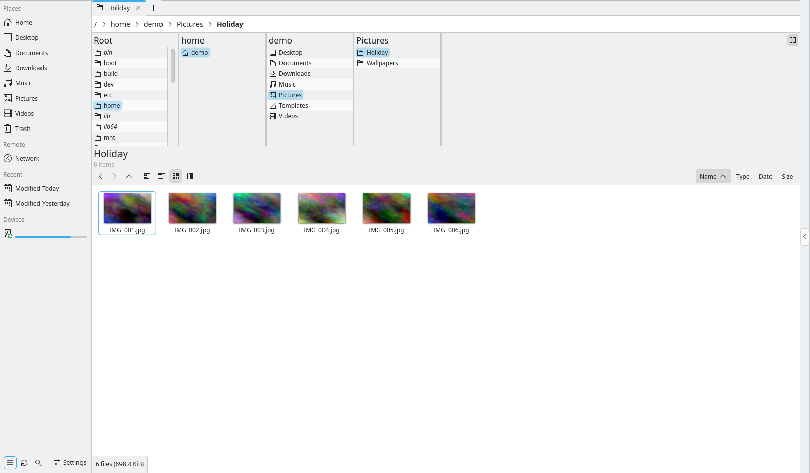

<div align="center">


# dolphinCommander

**A fast, keyboard-friendly, two-sided file manager for Linux, built on KDE's Dolphin.**

[](https://github.com/natefun/dolphinCommander/releases/latest)
[](https://aur.archlinux.org/packages/dolphincommander)
[](https://github.com/natefun/dolphinCommander/actions/workflows/release.yml)
[](LICENSES/)
[](https://develop.kde.org/frameworks/)

[Features](#features) · [Screenshots](#screenshots) · [Installation](#installation) · [Building from source](#building-from-source) · [Contributing](#contributing)


</div>

## About

dolphinCommander is a fork of [Dolphin](https://apps.kde.org/dolphin/), KDE's file manager, that works more like [OneCommander](https://onecommander.com/) and the classic two-panel commanders: two sides next to each other, each with its own tabs, a path bar and Miller columns, and one row of buttons below the places instead of menus and a toolbar.

It keeps everything that makes Dolphin good (KIO, network locations, previews, the context menu, service menus, Baloo search) and installs next to it without touching Dolphin's settings.

> [!NOTE]
> dolphinCommander is an independent project. It is not affiliated with or endorsed by KDE. It is young and used daily by its author, but it has not been tested widely yet: bug reports are welcome.

## Features

### Two sides, always

- **Left and right side**, each with its own tab bar, tabs and new-tab button. Drag tabs between the sides.
- **Hide either side** with the arrows in the middle of the divider, or by dragging the divider to the edge. The same arrows bring it back.
- **Copy and move between sides** with `F5` and `F6`, or "Open in Other Pane" from the context menu.
- **Synchronized browsing:** the other side follows when you enter a folder or go up.
- **Compare folders:** select what differs between the two sides.

### Navigation

- **Large breadcrumb path bar** above each side that always shows the full path.
- **Miller columns** above each file list, one column per parent folder. They resize with the window and never scroll sideways.
- **Columns view with a file preview** on the right.
- **Double-click empty space to go up** a folder (can be turned off in Settings → View → General).
- **Folder hotlist** to jump to your favourite places, and **workspaces** that save and restore a set of tabs.
- **Browse into archives** like folders, and pack or unpack them with Ark from the keyboard.

### Tools

- **Rename by pattern**, with a preview.
- **Checksums:** calculate them for a file and check against a known one.
- **Quick view** of the selected file, on the other side.

### A cleaner window

- **One row of buttons below the places**: a menu button with everything from Dolphin's menus, refresh, search and settings. Back, forward and up are in the header of every view.
- **No telemetry, no links to KDE services.** KUserFeedback, the KDE Store button and the About KDE, Report Bug and Donate entries are removed, and crash reports are not sent anywhere.
- **Lives next to Dolphin.** Its own program name (`dolphincommander`), settings file (`~/.config/dolphincommanderrc`) and D-Bus name, and it does not take over the file manager D-Bus service.

### Keyboard shortcuts

| Shortcut | Action |
| --- | --- |
| `F5` / `F6` | Copy / move the selection to the other side |
| `Ctrl+F3` | Move the focus to the other side |
| `Ctrl+Alt+S` | Synchronized browsing |
| `Ctrl+Shift+F2` | Compare folders |
| `Ctrl+Shift+F6` | Rename by pattern |
| `Ctrl+Shift+F7` | Checksum |
| `Ctrl+Shift+F8` | Folder hotlist |
| `Alt+F3` | Quick view |
| `Alt+F5` / `Alt+F9` | Pack the selection / unpack to the other side |
| `Ctrl+I` or `/` | Filter the current folder |
| `Ctrl+1` … `Ctrl+4` | Icons, Compact, Details or Columns view |

All shortcuts can be changed from the menu button, under Configure → Configure Keyboard Shortcuts.

## Screenshots

<table>
  <tr>
    <td width="50%"><br><sub>Everything from Dolphin's menus and toolbar is in the menu button below the places.</sub></td>
    <td width="50%"><br><sub>The right side hidden with the divider, and pictures in the Icons view.</sub></td>
  </tr>
  <tr>
    <td width="50%"><br><sub>The Columns view, with a preview of the selected file.</sub></td>
    <td width="50%"><br><sub>Two sides, each with its own tabs, path bar and Miller columns.</sub></td>
  </tr>
</table>

## Installation

### Arch Linux and Manjaro

dolphinCommander is in the AUR as `dolphincommander`. With an AUR helper:

```bash
yay -S dolphincommander      # or: paru -S dolphincommander
```

Without a helper:

```bash
git clone https://aur.archlinux.org/dolphincommander.git
cd dolphincommander
makepkg -si
```

Or download the package of the latest [release](https://github.com/natefun/dolphinCommander/releases) and install it with:

```bash
sudo pacman -U dolphincommander-*.pkg.tar.zst
```

The package installs under `/opt/dolphincommander`, with a `dolphincommander` launcher in `/usr/bin` and an entry in the application menu, so it does not get in the way of Dolphin. Remove it with `sudo pacman -R dolphincommander`.

> [!TIP]
> A new release comes out every week that has changes, with the latest fixes from Dolphin merged in. See [fork/README.md](fork/README.md) for how releases are made.

### Other distributions

There are no packages for other distributions yet. Build it from source as described below. It needs KDE Frameworks 6.23 or newer, which rolling distributions such as openSUSE Tumbleweed have but Ubuntu and Debian stable do not yet.
## Building from source

dolphinCommander is based on the development version of Dolphin (KDE Gear 26.11), so it needs recent Qt 6 and KDE Frameworks 6 (6.23 or newer) with their development files, CMake, Ninja (or Make) and a C++ compiler.

### 1. Install the dependencies

On Arch Linux and Manjaro:

```bash
sudo pacman -S --needed base-devel git cmake ninja extra-cmake-modules \
    qt6-base qt6-multimedia qt6-tools \
    kbookmarks kcmutils kcodecs kcolorscheme kcompletion kconfig kcoreaddons kcrash \
    kdbusaddons kdoctools kguiaddons ki18n kiconthemes kio knotifications kparts \
    kservice ktextwidgets kwidgetsaddons kwindowsystem kxmlgui solid \
    kfilemetadata baloo baloo-widgets kio-extras
```

On other distributions, install the development packages of the same Qt 6 modules and KDE Frameworks. CMake lists any missing package when it configures. Baloo (file search and the information panel), KFileMetaData and PackageKit are optional; `kio-extras` is only needed at run time, for thumbnails and more locations.

### 2. Get the code and build it

```bash
git clone https://github.com/natefun/dolphinCommander.git
cd dolphinCommander
cmake -S . -B build -G Ninja \
    -DCMAKE_BUILD_TYPE=RelWithDebInfo \
    -DBUILD_TESTING=OFF \
    -DCMAKE_INSTALL_PREFIX=$HOME/.local
cmake --build build
```

Add `-DBUILD_TESTING=ON` to build the tests as well, and run them with `ctest --test-dir build`. `fork/ci-build-and-test.sh` builds and checks the tests the same way the GitHub workflows do.

### 3. Try it without installing

```bash
LD_LIBRARY_PATH=build/bin build/bin/dolphincommander
```

### 4. Install it

```bash
cmake --install build
```

With the prefix above, this installs into `~/.local` and needs no root. The program finds its settings pages and other plugins through `QT_PLUGIN_PATH`, so start it like this (or put the two `export` lines in `~/.profile`):

```bash
export QT_PLUGIN_PATH="$HOME/.local/lib/plugins${QT_PLUGIN_PATH:+:$QT_PLUGIN_PATH}"
export XDG_DATA_DIRS="$HOME/.local/share:${XDG_DATA_DIRS:-/usr/local/share:/usr/share}"
dolphincommander
```

Some distributions put plugins in `lib64/plugins` or `lib/qt6/plugins` instead; `cmake --install` prints where they went.

> [!WARNING]
> Do not install it with the prefix `/usr` when Dolphin is installed: both have `libdolphinprivate`, the same settings schemas and the same translations, and installing over them breaks Dolphin.
> Use `~/.local` or a folder of its own such as `/opt/dolphincommander`.

To uninstall, remove the files that the install listed:

```bash
xargs rm -f < build/install_manifest.txt
```
## Documentation

The handbook is installed with the program: press `F1` or open it from the menu button. It covers the sides, tabs, path bar, Miller columns, menu, filter, settings and keyboard shortcuts. Its source is [`doc/index.docbook`](doc/index.docbook).

For the parts that are unchanged from Dolphin, the [Dolphin documentation](https://userbase.kde.org/Special:myLanguage/Dolphin) still applies.

## Known limitations

- Which side is hidden is not saved: both sides are shown again after a restart.
- `F5` and `F6` also work while the other side is hidden, and then copy to a folder you cannot see.
- A few of Dolphin's own tests fail because of what the fork changes. They are listed, with the reason, in [`fork/expected-test-failures.txt`](fork/expected-test-failures.txt).

## Contributing

Bug reports, ideas and pull requests are welcome on the [issue tracker](https://github.com/natefun/dolphinCommander/issues). Please do not report problems in dolphinCommander to KDE.

Before you start:

- Read [fork/README.md](fork/README.md): it explains how Dolphin's changes are merged in every week and how to write fork code that keeps merging cleanly (new things go in new files, keep changes to Dolphin's code small).
- New features get a test in [`src/tests/dolphincommanderfeaturestest.cpp`](src/tests/dolphincommanderfeaturestest.cpp).
- Run `fork/ci-build-and-test.sh` before opening a pull request. It builds with tests and checks them the way CI does.

### Where the fork's code is

| Path | What it does |
| --- | --- |
| `src/dolphinmainwindow.cpp` | The two sides, which side is active, the button row and the commander actions |
| `src/sidessplitter.*` | The divider between the sides, with its arrows |
| `src/views/columnsstrip.*` | The Miller columns |
| `src/views/viewheader.*` | The header of each view, with back, forward and up |
| `src/views/filepreviewwidget.*` | The preview in the Columns view |
| `src/commandertools.*` | Hotlist, checksum, rename by pattern, quick view and workspaces |
| `fork/` | Upstream merging, CI and the Arch package |

## License and acknowledgements

dolphinCommander is free software, licensed under the [GNU General Public License, version 2 or later](LICENSES/GPL-2.0-or-later.txt). Some files are under other compatible licenses; see [`LICENSES/`](LICENSES/) and [`REUSE.toml`](REUSE.toml).

Most of the code is from [KDE's Dolphin](https://invent.kde.org/system/dolphin) and its many contributors. Thank you to the KDE community for building it.
